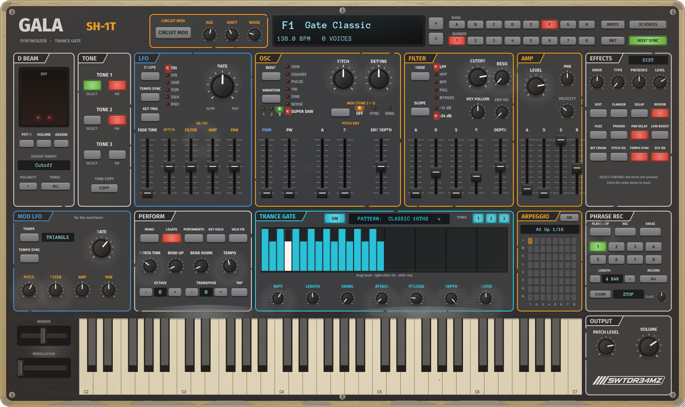

# GALA SH-1T

A three-tone virtual analog synth in the manner of the Roland **GAIA SH-01**, rebuilt as a modern **trance machine**:
a **VST3** for Windows and the Mac, an **AU** for the Mac and a **standalone app**. By **swtdr34mz**.

Unofficial: not made, endorsed or supported by Roland.



## Download

[Actions](https://github.com/swtdr34mz-afk/GALA_SH-1T/actions) → the newest green run → **Artifacts** at the bottom:
`GALA-SH-1T-Windows` or `GALA-SH-1T-macOS` (a GitHub sign-in is needed for artifacts). Releases have them too.

## Installieren (kurz auf Deutsch)

**Windows (Cubase):**
1. Zip entpacken.
2. Den Ordner `GALA SH-1T.vst3` nach `C:\Program Files\Common Files\VST3\` kopieren.
3. Cubase starten (oder *Studio → VST-PlugIn-Manager → Aktualisieren*). GALA SH-1T steht unter den Instrumenten,
   Hersteller swtdr34mz.
4. `GALA SH-1T.exe` ist die Standalone-App. Audio- und MIDI-Gerät stellt man unter *Options* ein.

Windows SmartScreen kann beim ersten Start der App warnen (sie ist nicht signiert): *Weitere Informationen →
Trotzdem ausführen*.

**Mac (Ableton, Logic, ...):** Am besten die `.tar.gz` nehmen. `GALA SH-1T.vst3` nach `~/Library/Audio/Plug-Ins/VST3/`,
`GALA SH-1T.component` nach `~/Library/Audio/Plug-Ins/Components/`. Dann einmal im Terminal:
```
xattr -cr ~/Library/Audio/Plug-Ins/VST3/"GALA SH-1T.vst3" ~/Library/Audio/Plug-Ins/Components/"GALA SH-1T.component"
```
Die Plugins laufen auf Apple Silicon und Intel-Macs (eine Datei für beide).

## What it has (the GAIA's, from its owner's manual)

- **Three TONES** per voice, each a whole synth: **OSC** (SAW, SQUARE, PULSE/PWM, TRIANGLE, SINE, NOISE, SUPER SAW,
  three **VARIATIONS** each; PITCH ±24, DETUNE ±50, PW, PWM, a pitch envelope A / D / DEPTH), **FILTER** (LPF, HPF, BPF,
  PKG, BYPASS; −12 or −24 dB; CUTOFF, RESONANCE, KEY FOLLOW, ADSR with DEPTH), **AMP** (LEVEL, ADSR, PAN), an **LFO**
  (triangle, sine, saw, square, S&H, random; TEMPO SYNC, FADE TIME, pitch / filter / amp / pan depth) and the
  **MODULATION LFO** (the mod lever's).
- **SYNC** and **RING**: tone 2's oscillator onto tone 1's (here in every voice, not only in mono).
- **64 voices** (or 8, 16, 32), **MONO** (with LEGATO), **PORTAMENTO**, the patch's octave, bend ranges up and down,
  **KEY HOLD**, velocity sensitivity for the filter envelope and the level, **REAL / FIX** velocity, transpose.
- **EFFECTS**: DIST / FUZZ / BIT CRASH, FLANGER / PHASER / PITCH SHIFTER, DELAY / PANNING DELAY (tempo sync), REVERB
  (room, plate, hall), LOW BOOST, each with its own parameters (the GAIA's CONTROL 1/2/3 and LEVEL).
- **ARPEGGIO**: 64 variations, A1 to H8 (up, down, up and down, random, chords, trance pedal and bounce, bass, as played).
- **D BEAM**: the mouse over the pad is the hand (or automate *D Beam*): PITCH, VOLUME or ASSIGN to 33 targets, with
  polarity.
- **PHRASE RECORDER**: eight phrases of up to eight bars; notes, the bender and the knobs, recorded after a bar's
  count-in with a metronome, looped (overdub, rehearse with REC, erase while held), played back. Saved with the project.
- **64 factory patches** in eight banks (leads, super saws, pads, basses, plucks and arps, trance gate, keys and bells,
  FX and retro); WRITE keeps your own (Documents/GALA SH-1T/Patches).

## What GALA adds

- **No SHIFT**: everything the GAIA hides under SHIFT has its own control (pan, velocity, LFO key trigger, the mod
  LFO, the effects' second and third controls, bend ranges, portamento time, ...).
- **TRANCE GATE**: a step gate of up to 32 steps on the tones you choose (1, 2, 3): each step's level, ties, rate
  (1/4 to 1/32, triplets), swing, attack, release, depth, and a filter amount that opens the cutoff with the gate.
  Its own **pattern menu** of 40 modern trance gate sequences; or draw your own.
- **CIRCUIT MOD**: the voices as an old machine's. Each voice has its own parts (a little sharp or flat, its filter a
  touch brighter or darker, its envelopes a little slower), drifts on its own, the highs tired, hiss and mains hum
  with the sound. AGE, DRIFT, NOISE. (Its button flickers.)
- **HOST SYNC**: the gate, the arpeggio, synced LFOs and delays follow the DAW's tempo and position.

Tips: SELECT with **Shift** picks several tones at once (the knobs then edit all of them). In the gate: drag to draw
levels, Alt-click for a tie, Shift-click for a rest. Double-click a knob: its default. **Right-click** a knob, fader,
button or LED choice: the DAW's own menu for that parameter (MIDI Learn, automation); a right-click never changes a value.

## Building

```
cmake -B build -DCMAKE_BUILD_TYPE=Release
cmake --build build --config Release
```
JUCE 8 comes from GitHub. The engine's tests: `cmake -S tests -B build-tests && cmake --build build-tests && build-tests/engine_tests`.

## Licence

MPL-2.0 (LICENSE). Fonts: Fira Sans and Anonymous Pro, SIL Open Font License (fonts/).
